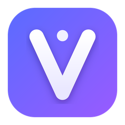
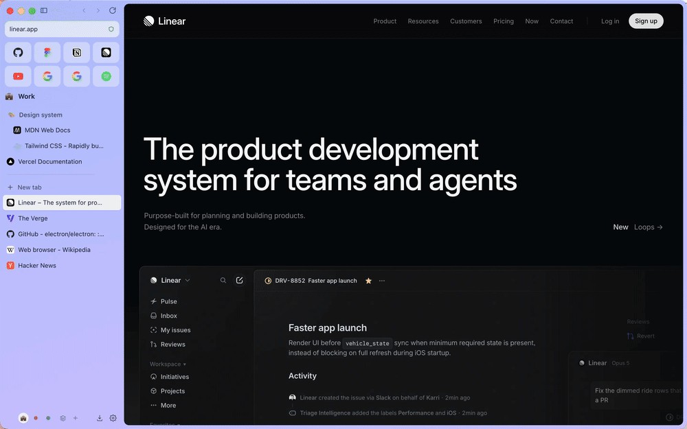
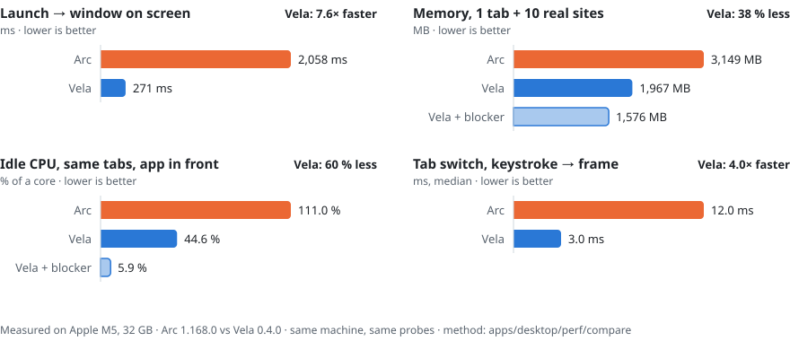
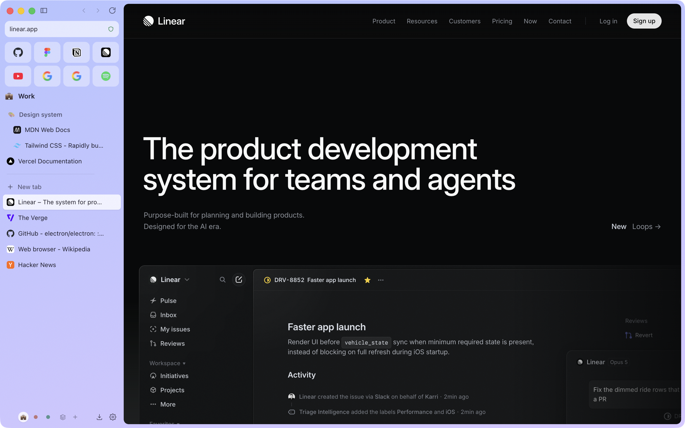
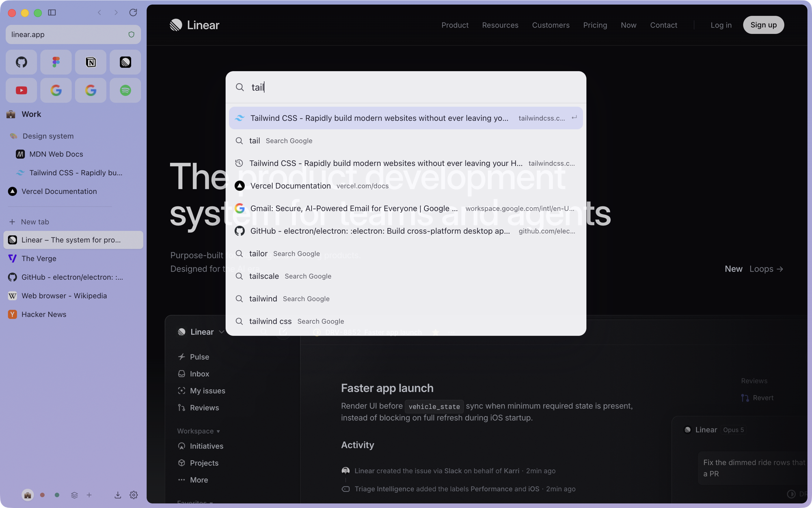
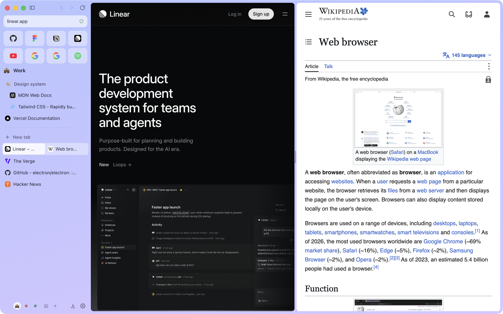
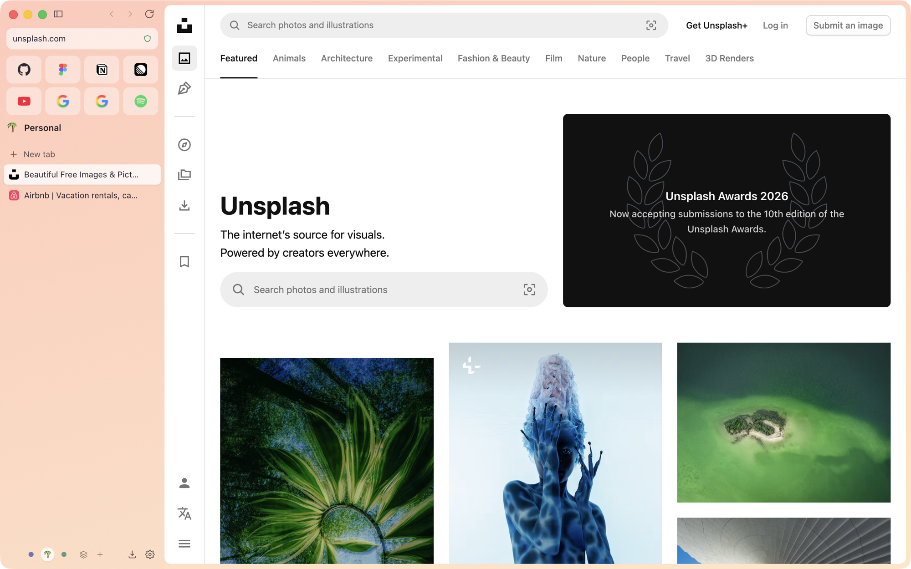

<p align="center">
  
</p>

<h1 align="center">Vela</h1>

<p align="center">
  <b>The open-source Arc browser alternative.</b><br>
  Spaces, vertical tabs, the command bar, Peek, split view, Boosts. Chromium inside.<br>
  Imports your whole Arc sidebar in one click. Lighter than Arc, and it keeps shipping.
</p>

<p align="center">
  <a href="https://github.com/JoSanson/vela/releases/latest"></a>
  <a href="https://github.com/JoSanson/vela/releases"></a>
  <a href="https://github.com/JoSanson/vela/actions/workflows/ci.yml"></a>
  <a href="apps/desktop/package.json"></a>
  <a href="LICENSE"></a>
  <a href="CONTRIBUTING.md"></a>
</p>

<p align="center">
  <a href="https://github.com/JoSanson/vela/releases/latest"><b>Download for macOS</b></a> ·
  <a href="https://github.com/JoSanson/vela/releases/latest"><b>Windows</b></a> ·
  <a href="https://github.com/JoSanson/vela/releases/latest"><b>Linux</b></a> ·
  <a href="docs/MIGRATING-FROM-ARC.md">Switching from Arc</a> ·
  <a href="docs/BENCHMARK.md">Benchmark</a> ·
  <a href="#contributing">Contribute</a>
</p>

<p align="center">
  
</p>

## Why Vela exists

Arc changed how a lot of us use the web: a sidebar instead of a tab strip, Spaces for each part of
your life, a command bar instead of a URL bar, tabs that tidy themselves up. In May 2025 The Browser
Company stopped building new Arc features to focus on Dia. Arc still gets security patches, but the
browser many of us fell for is frozen.

Vela is the answer to "what now?":

- **It feels like home.** Sidebar, Spaces, favorites, pinned folders, Today tabs that archive
  themselves, `⌘T` command bar, Peek, split view, Little windows, Boosts, Air Traffic Control. The
  shortcuts you already have in your fingers work.
- **It cannot be shelved.** GPL-3.0, built in the open. No company can freeze it or turn it into a
  closed product: every version of Vela, and of any fork, stays open source.
- **It stays fresh.** A bot checks for a new Chromium (via Electron) every 6 hours, runs the whole
  test suite and ships a release on its own. You get engine and security updates without waiting
  for anyone.
- **It is light.** Measured, not claimed: see below.

## Lighter than Arc, measured

<p align="center">
  <a href="docs/BENCHMARK.md"></a>
</p>

Same Mac, same pages, same probes, both browsers driven by the same script: launch timed by the
macOS WindowServer, memory read as `phys_footprint` over every process (what Activity Monitor
shows), CPU from the kernel's per-process counters, tab switch from a real `⌘⌥↓` keystroke to the
next painted frame. "Vela" bars run with the content blocker **off**, so both browsers download
exactly the same thing. Page loads are a tie: it is the same Blink engine underneath.

Full method, raw numbers, caveats and the script to run it on your own machine:
[docs/BENCHMARK.md](docs/BENCHMARK.md). Disagree with a number? Run it and open an issue.

## Bring your whole Arc with you

Vela offers it on first launch (later: Settings → Import & export → **Arc**). One click brings
over:

| From Arc | In Vela |
| --- | --- |
| Spaces, with their names, emoji and colours | Spaces |
| Profiles attached to Spaces | Profiles attached to the same Spaces |
| Favorites (the top grid) | Favorites, per profile |
| Pinned tabs and nested folders | Pinned tabs and nested folders |
| History | Full-text searchable history |
| Saved passwords and cookies | Encrypted with your OS keychain; you stay logged in |

Run it again later and it merges instead of duplicating. Chrome, Brave, Edge, Safari and Firefox
imports are there too. Step by step, and the shortcut cheat sheet:
[docs/MIGRATING-FROM-ARC.md](docs/MIGRATING-FROM-ARC.md).

## A quick tour

<table>
  <tr>
    <td width="50%"><br><b>Sidebar, not tabs.</b> Favorites → Pinned (nested folders) → Today. Today tabs archive themselves after 12 h, 24 h, 7 or 30 days; the archive is searchable.</td>
    <td width="50%"><br><b>Command bar.</b> <code>⌘T</code> searches open tabs, favorites, history (full text), the archive and browser commands in a few milliseconds. <code>y</code> ⇥ YouTube, <code>gh</code> ⇥ GitHub, your own keywords.</td>
  </tr>
  <tr>
    <td width="50%"><br><b>Split view</b> with 2 to 4 panes, <b>Peek</b> for links from pinned tabs, <b>Little Vela</b> windows for links opened from other apps.</td>
    <td width="50%"><br><b>Spaces</b> with their own tabs, gradient theme (grain, light/dark, palette from an image, glass) and an optional isolated <b>profile</b>.</td>
  </tr>
</table>

**Chrome extensions** install from the Chrome Web Store in one click ("Add to Vela"), update
themselves and get their buttons in the sidebar: 1Password, Dark Reader, Vimium, Bitwarden,
Grammarly… ([compatibility list](docs/EXTENSIONS.md)).

Also built in: password manager (OS keychain, never leaves your machine), content blocker, auto
picture-in-picture, Boosts (per-site CSS/JS and a Zap element picker), reader mode, Air Traffic
Control rules that route links to the right Space, multiple windows, private Spaces, safe browsing
checked locally, rebindable shortcuts, English and French UI.

## Arc and Vela, feature by feature

| | Arc | Vela |
| --- | :-: | :-: |
| Vertical sidebar, Favorites, Pinned, Today | ✅ | ✅ |
| Spaces with themes, Profiles | ✅ | ✅ |
| Command bar, tab search, auto-archive | ✅ | ✅ |
| Split view, Peek, Little window | ✅ | ✅ |
| Boosts, Air Traffic Control, auto PiP | ✅ | ✅ |
| One-click import of your Arc sidebar and passwords | n/a | ✅ |
| Built-in content blocker | ❌ | ✅ |
| Linux | ❌ | ✅ |
| Open source | ❌ | ✅ GPL-3.0 |
| New features | frozen since May 2025 | shipping |
| Chrome extensions from the Chrome Web Store | ✅ | ✅ [most popular ones](docs/EXTENSIONS.md#compatibility-the-20-most-used-extensions) |
| Netflix / DRM video (Widevine) | ✅ | ❌ not yet ([help wanted](https://github.com/JoSanson/vela/issues?q=is%3Aissue+label%3Aarc-parity)) |
| Easels, Notes, AI features | ✅ | ❌ not yet |
| Sync between devices, mobile app | ✅ | ❌ not yet |

Something you used every day in Arc and miss here?
[Tell us with the "Arc feature I miss" template](https://github.com/JoSanson/vela/issues/new?template=arc_feature.yml).
The most-upvoted ones are built first.

## Install

**macOS** (Apple silicon and Intel): download the `.dmg` from the
[latest release](https://github.com/JoSanson/vela/releases/latest) and drag Vela to Applications.
Builds are not notarized by Apple yet, so the first launch needs one extra step: open it, then
System Settings → Privacy & Security → **Open Anyway**. Or, in Terminal:
`xattr -dr com.apple.quarantine /Applications/Vela.app`.

**Windows**: run the `.exe` installer. SmartScreen may warn about an unknown publisher: More info →
Run anyway.

**Linux**: `.AppImage` (any distro) or `.deb` (Debian, Ubuntu).

Vela updates itself from GitHub Releases. Prefer to build it yourself? See [Develop](#develop).

## Develop

```bash
pnpm install          # Node ≥ 22, pnpm 10; rebuilds better-sqlite3 for Electron
pnpm dev              # electron-vite with HMR
pnpm build            # installer for the current OS → apps/desktop/release
pnpm test             # unit tests (Vitest), pnpm coverage for the report
pnpm e2e              # Playwright _electron suite
pnpm perf             # performance budgets → PERF.md
pnpm ci:local         # everything CI runs
```

Electron (no fork, no `<webview>`): one `WebContentsView` per tab, a React 19 shell, a pure
TypeScript core for tabs, Spaces and the command bar ranking. Sandboxed renderers, context
isolation, typed IPC, strict CSP. Start with [ARCHITECTURE.md](ARCHITECTURE.md), then
[SECURITY.md](SECURITY.md) and [DECISIONS.md](DECISIONS.md) for the why.

## Contributing

Vela is built by people who miss Arc. You do not need to be a browser engineer:

- **Good first issues** are labelled
  [`good first issue`](https://github.com/JoSanson/vela/labels/good%20first%20issue). Translations
  (one file per language) are a great start.
- **Arc parity** work is labelled
  [`arc-parity`](https://github.com/JoSanson/vela/labels/arc-parity): the features that would make
  the last Arc users switch.
- **Ideas and questions** go to [Discussions](https://github.com/JoSanson/vela/discussions).

Read [CONTRIBUTING.md](CONTRIBUTING.md) (10 minutes from clone to your first change running). Every
merged PR lands in the next release with your name in the notes.

## Keyboard shortcuts

`vela://shortcuts` lists everything and lets you rebind any of it. The defaults match Arc where Arc
had one (⌘ on macOS, Ctrl elsewhere):

| Action                     | Shortcut            |
| -------------------------- | ------------------- |
| New tab / command bar      | `⌘T`                |
| Edit current URL           | `⌘L`                |
| Close tab / reopen         | `⌘W` / `⌘⇧T`        |
| Pin / unpin                | `⌘D`                |
| Copy URL / as Markdown     | `⌘⇧C` / `⌘⇧⌥C`      |
| Next / previous tab        | `⌘⌥↓` / `⌘⌥↑`       |
| Go to tab N                | `⌘1…9`              |
| Switch to recent tab       | `Ctrl+Tab`          |
| Toggle sidebar             | `⌘S`                |
| Split view / close pane    | `⌃⇧+` / `⌃⇧-`       |
| Spaces                     | `Ctrl+1…9`, `⌘⌥←/→` |
| New space / all spaces     | `⌃⌘N` / `⌘⇧S`       |
| Archived tabs / History    | `⌘⇧L` / `⌘Y`        |
| Little Vela window         | `⌘⌥N`               |
| Find in page / reader mode | `⌘F` / `⌘⌥R`        |

## FAQ

**Is Arc dead?** Not dead, frozen. The Browser Company stopped building new Arc features in May
2025 and moved the team to Dia (the company was acquired by Atlassian later that year). Arc still
receives Chromium security patches. If you are happy with Arc as it is, keep it. Vela is for when
you want it to keep moving.

**Is Vela a fork of Arc?** No. Arc is closed source, so there is nothing to fork. Vela is written
from scratch and borrows ideas, not code, names or assets.

**Why Chromium and not Firefox?** Sites, web apps and extensions are built and tested for Chromium
first, and that is what Arc users are used to. If you prefer Gecko, Zen is a great project.

**Do my Chrome extensions work?** Install them straight from the Chrome Web Store. Of the 20 most
used, 16 work fully or with minor glitches today, tested one by one in
[docs/EXTENSIONS.md](docs/EXTENSIONS.md). Ad blockers load but rely on an API Electron lacks; Vela's
built-in blocker does that job.

**Why Electron?** It ships a current Chromium within days of Google, on macOS, Windows and Linux,
without maintaining a fork of 30 million lines. The shell idles at ~110 MB; see the benchmark.

**Will it keep being updated?** Engine updates are automated (a check every 6 hours, full CI, then
a release). Features ship in regular releases. And because it is GPL-3.0, the project does not depend on any one
person or company.

**Does it phone home?** No telemetry, no account. Crash dumps stay on your disk. Update checks hit
GitHub Releases.

## Star history

<a href="https://star-history.com/#JoSanson/vela&Date">
  
</a>

If Vela is useful to you, a star helps other Arc users find it.

---

<sub>Vela is an independent open-source project, not affiliated with, endorsed by or connected to
The Browser Company or Atlassian. "Arc" and "Dia" are trademarks of their respective owners and are
used here only to describe compatibility and compare features. Vela is free software under the
[GPL-3.0](LICENSE); the Vela name and logo are reserved, see [TRADEMARKS.md](TRADEMARKS.md).</sub>
